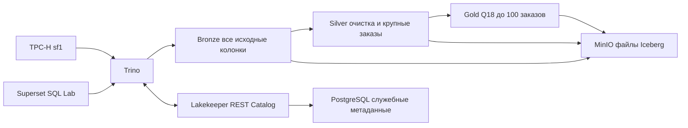

# Практическая работа №1

**Тарасов Глеб Святославович** · Вариант 3 · TPC-H Q18 Large Volume Customer · SF1

В работе реализован поток TPC-H → Bronze → Silver → Gold и сравнение форматов и кодеков. Полный отчёт по форме преподавателя: [отчёт.md](отчёт.md). Источник фактических результатов указан в начале отчёта: локальная проверка DuckDB и контейнерный Trino не смешиваются.

S3-хранилище разворачивается на Silo — поддерживаемом форке MinIO из актуального официального примера Lakekeeper. Сервис в Compose называется `minio`, протокол и настройки остаются S3-совместимыми. Исходный публичный образ MinIO недоступен; это замена технологии хранилища, разрешённая формой отчёта.

## Архитектура



Gold содержит **заказы**, а не уникальных клиентов: один клиент может иметь несколько крупных заказов. Условие `sum(quantity) > 300` строгое. Сортировка: стоимость по убыванию, дата, затем orderkey для воспроизводимости. `LIMIT 100` не добавляет строки, если подходящих заказов меньше ста.

## Запуск в Windows

Нужны Docker Desktop с Linux containers, Docker Compose v2, 8–12 ГБ доступной памяти и место под образы и несколько копий SF1. При первом запуске потребуется загрузка образов из официальных реестров.

Открой PowerShell в каталоге проекта:

```powershell
.\start.ps1 -ScaleFactor 1 -Repeats 5
```

Сценарий поднимает MinIO, PostgreSQL, Lakekeeper, Trino, создаёт слои, сравнивает 6 сочетаний формата и кодека, проверяет schema evolution, time travel и rollback, подключает Superset к Bronze и обновляет отчёт по фактическим замерам. Ошибка любого обязательного шага останавливает сценарий.

Для Linux и macOS: `sh start.sh`.

## Интерфейсы после локального запуска

| Сервис | Адрес | Учебный вход |
|---|---|---|
| Trino | http://localhost:8080 | student |
| MinIO | http://localhost:9001 | minio-root-user / minio-root-password |
| Lakekeeper | http://localhost:8181 | локальная конфигурация без аутентификации |
| Superset | http://localhost:8088 | student / Practice1-local! |

Это конфигурация для одной учебной машины: опубликованные порты доступны только на loopback. Пароли демонстрационные. Для общего сервера нужна отдельная конфигурация доступа.

В Superset открой SQL → SQL Lab, Database → Lakehouse, Schema → bronze и выполни:

```sql
SELECT orderkey, sum(quantity) AS qty
FROM lake.bronze.lineitem
GROUP BY orderkey HAVING sum(quantity) > 300
ORDER BY qty DESC, orderkey LIMIT 10;
```

Для витрины:

```sql
SELECT * FROM lake.gold.q18_top100
ORDER BY totalprice DESC, orderdate, orderkey;
```

Автоматизированная консольная проверка того же BI-подключения записывает `results/bi-bronze.json`.

## Проверки и результаты

| Файл | Содержимое |
|---|---|
| `sql/q18.sql` | Исходный Q18 с параметром схемы |
| `sql/silver.sql`, `sql/gold.sql` | ELT и витрина |
| `scripts/run_trino.py` | Контейнерный запуск и реальные HTTP-запросы Trino |
| `results/trino/queries.jsonl` | SQL, query ID, время клиента и серверные stats |
| `results/trino/layers.json` | Строки и физический размер активных файлов Iceberg |
| `results/trino/benchmark.json` | Все повторы по форматам и кодекам |
| `results/trino/evolution.json` | Фактический snapshot ID и проверки восстановления |
| `results/trino/docker-ps.txt` | Состояние контейнеров |
| `results/bi-bronze.json` | Запрос Bronze из контейнера Superset |
| `results/local/` | Отдельные фактические замеры DuckDB на Windows |

Проверяются равенство Gold исходному Q18 и Q18 по Bronze, уникальность ключей, внешние ключи, число отклонённых строк, результат для каждого кодека и восстановление данных после удаления. Изменение схемы демонстрируется на отдельной копии Silver, чтобы сохранить основные слои.

На Bronze сохраняются все колонки. На Silver отбрасываются ненужные поля, задаются типы и фильтры качества; `large_orders` предварительно агрегирует lineitem. Партиционирование не включено: у Q18 нет фильтра по дате, а на SF1 лишние разделы увеличивают число мелких файлов.

## Методика бенчмарка

Для каждой конфигурации используются одни и те же строки и колонки SF1. В контейнерном сценарии сравниваются Parquet NONE/SNAPPY/GZIP/ZSTD и ORC GZIP/ZSTD. Выполняется 5 записей трёх Bronze-таблиц, затем прогрев и 5 полных запросов Q18; результат — медиана и диапазон. Запись CTAS включает генерацию данных и commit, но не удаление предыдущих таблиц. Размер измеряется по `$files`, а не оценке `SHOW STATS`.

Локальная проверка дополнительно сравнивает CSV с явной схемой и Parquet. Она нужна для независимой проверки SQL и не подменяет Docker/Trino. Кеш ОС не очищается; результаты описывают повторное чтение. Генерируемые данные исключены из Git.

## Независимая локальная проверка без Docker

Python 3.12:

```powershell
python -m venv .venv
.\.venv\Scripts\python -m pip install -r requirements-local.txt
.\.venv\Scripts\python scripts/local_check.py --sf 1 --repeats 5
.\.venv\Scripts\python scripts/make_report.py --engine local
```

Последняя команда явно формирует отчёт с пометкой о локальной проверке. Контейнерный отчёт создаётся только при наличии маркера успешного запуска Trino и доказательства BI-запроса.

## GitHub Actions

Workflow `Verify lakehouse` разворачивает тот же Compose-стек на одной машине Ubuntu в GitHub Actions. После успешного запуска он сохраняет исходники и отчёт в репозитории, а доказательства — также в downloadable artifact. Среда GitHub указывается в отчёте; это не запуск Docker на личном Windows-компьютере.

Для повторного запуска: Actions → Verify lakehouse → Run workflow. Временные контейнеры удаляются по окончании работы, файлы отчёта остаются в Git.

## Завершение локальной работы

```powershell
docker compose --profile bi down
```

Именованные volumes при этом сохраняются. Повторный `start.ps1` пересоздаёт только таблицы этой практической работы в её warehouse. Удаление volumes не требуется для штатного повторного запуска.

## Сдача

В форму VK Education нужно отправить ссылку на этот публичный репозиторий. Код, методология, результаты и заполненный `отчёт.md` хранятся вместе. Отдельную ссылку на форму преподавателя сдавать как свой результат не нужно.
